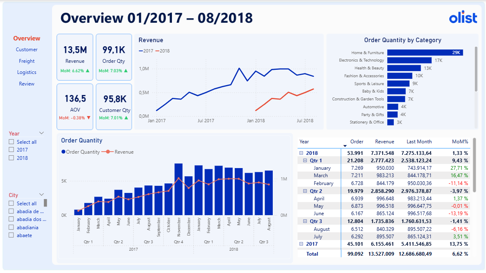
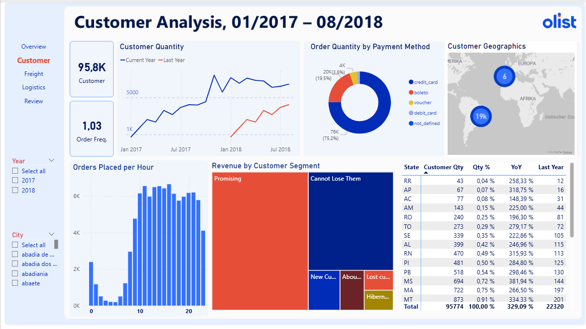
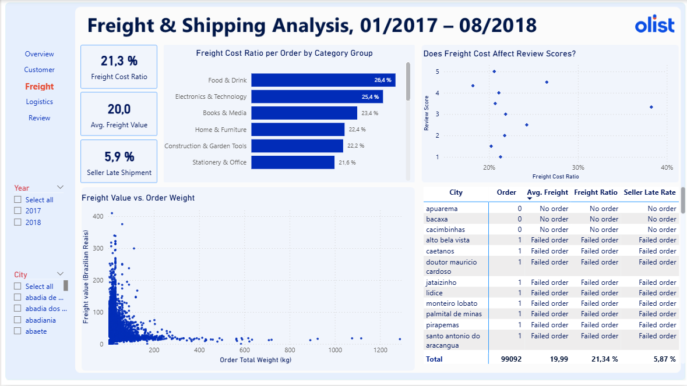
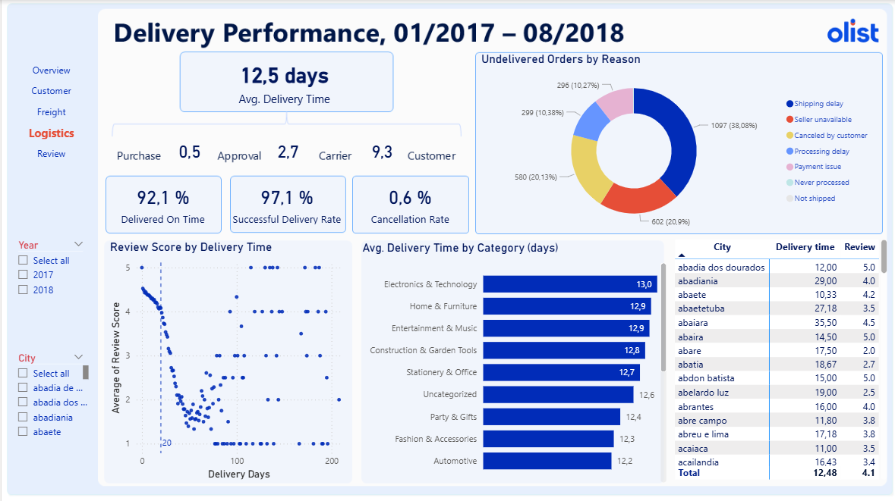
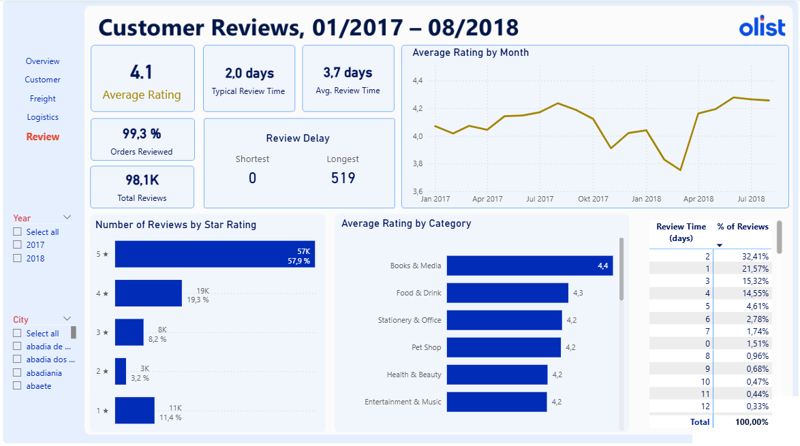
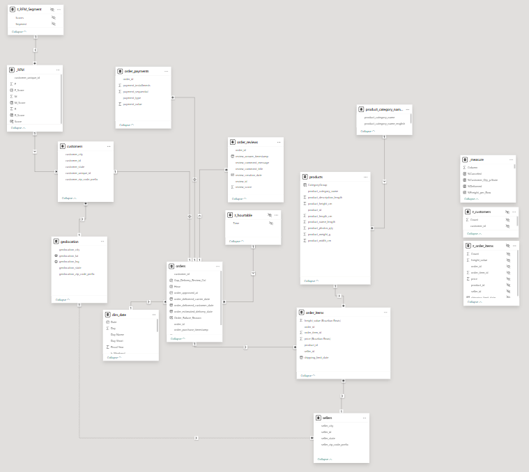

# 🛒 Brazilian E-Commerce Analytics (Olist)


This project analyzes the public dataset from **Olist**, a major Brazilian e-commerce marketplace: **99,092 orders**, **95,774 customers** and **~13.5M BRL** in revenue between **Jan 2017 and Aug 2018**. The report has 5 pages (Overview, Customer, Freight, Logistics, Review) that answer questions about revenue growth, customer behavior (**RFM** segmentation), shipping costs, delivery performance and customer satisfaction. It is built in **Power BI**, with **Power Query** for data cleaning and **DAX** for the metrics (70+ measures).

📦 Data source: [Brazilian E-Commerce Public Dataset by Olist – Kaggle](https://www.kaggle.com/datasets/olistbr/brazilian-ecommerce)

🔗 **[View the interactive Power BI report]https://app.powerbi.com/groups/me/reports/4f31ba5a-87ed-4853-8161-6ca2b7595ce1/e9b4c45a3916a5983ac1?experience=power-bi**
---


## 🎯 Business Questions


1. How do revenue, orders and customers grow month over month and year over year (MoM, YoY)?
2. Which product groups sell best? At what time of day do customers buy, and how do they pay?
3. Do customers come back? Which customer segments generate the most revenue (RFM)?
4. What share of the order value goes to freight, and does it affect review scores?
5. How long does an order take to reach the customer, which stage is the slowest, and why do some orders never arrive?
6. How does delivery time affect the `Review Score`?


---


## 🛠️ Tools & Techniques


* **Main tool:** Microsoft Power BI Desktop
* **Power Query (M):** Data type standardization, column renaming, filtering to the analysis period (Jan 2017 – Aug 2018), removing duplicate zip codes from `geolocation`, filling missing product categories with `Others`.
* **Data Modeling:** **Star schema** with fact tables `orders`, `order_items`, `order_payments`, `order_reviews` and dimension tables `customers`, `products`, `sellers`, `geolocation`, `dim_date`.
* **DAX:** Time intelligence (`SAMEPERIODLASTYEAR`, `DATEADD`), MoM/YoY indicators with dynamic arrows and colors, **RFM** segmentation via a calculated table (`SUMMARIZECOLUMNS`, `PERCENTILE.EXC`), `CROSSFILTER` for filtering by product group, and `MEDIANX` / `AVERAGEX` for time-based metrics.


---


## 📁 Project Structure


```text
├── data/
│   ├── orders.csv                              # Orders: status and purchase/approval/carrier/delivery timestamps
│   ├── order_items.csv                         # Items per order: price, freight, seller, shipping deadline
│   ├── order_payments.csv                      # Payment method and number of installments
│   ├── order_reviews.csv                       # Review score (1–5) and review timestamps
│   ├── customers.csv                           # Customers: ID, city, state
│   ├── products.csv                            # Products: category, dimensions, weight
│   ├── sellers.csv                             # Sellers: city, state
│   ├── geolocation.csv                         # Coordinates (lat/lng) by zip code prefix
│   ├── product_category_name_translation.csv   # Category name translation (Portuguese → English)
│   └── RFM_Ranking.xlsx                        # Mapping of RFM scores to customer segment names
├── images/
│   ├── data-model.png                          # Data model diagram
│   ├── overview.png                            # Screenshots of each report page
│   ├── customer.png
│   ├── freight.png
│   ├── logistics.png
│   └── review.png
├── Olist_report.pbix                           # Power BI report file
└── README.md                                   # Project documentation
```


---


## 🖼️ Dashboard Preview


### 1. Overview
KPI cards (Revenue, Orders, AOV, Customers) with month-over-month change, revenue trend vs. same period last year, orders by product group, and a Year → Quarter → Month revenue matrix.



### 2. Customer
Customers over time, purchase frequency, customer map, payment method mix, orders by hour of day, and revenue by RFM segment.



### 3. Freight
Freight as a share of item value, average freight cost, late seller handoff rate, and how freight relates to order weight and review scores.



### 4. Logistics
Average delivery time broken down by stage (Purchase → Approval → Carrier handoff → Customer), delivered / canceled / early delivery rates, reasons for undelivered orders, and review score by delivery time.



### 5. Review
Average rating, star distribution, rating by month and by product group, and days between delivery and review.




---


## 🗂️ Data Model




| Table | Type | Relationships |
| :--- | :--- | :--- |
| **orders** | Fact | `customer_id` → `customers` · `order_purchase_timestamp` → `dim_date` · `Hour` → `z_hourtable` |
| **order_items** | Fact | `order_id` → `orders` · `product_id` → `products` · `seller_id` → `sellers` |
| **order_payments** | Fact | `order_id` → `orders` |
| **order_reviews** | Fact | `order_id` → `orders` |
| **customers** | Dimension | `customer_zip_code_prefix` → `geolocation` · `customer_unique_id` → `_RFM` |
| **products** | Dimension | `product_category_name` → `product_category_name_translation` |
| **sellers** | Dimension | `seller_zip_code_prefix` → `geolocation` (inactive relationship) |
| **dim_date** | Dimension | Date table built with DAX `CALENDAR` (Jan 1, 2017 – Aug 31, 2018) |
| **_RFM**, **z_RFM_Segment** | Analysis tables | R/F/M scores per customer and segment names |
| **Delivery_Review_Table**, **Freight%_Review_Table** | Analysis tables | Order-level tables for the scatter charts |


---


## 📖 Data Dictionary


| Column | Table | Data Type | Description |
| :--- | :--- | :--- | :--- |
| **order_id** | orders | Text | Unique order identifier |
| **order_status** | orders | Categorical | Order status (`delivered`, `shipped`, `canceled`, `unavailable`,...) |
| **order_purchase_timestamp** | orders | Date | Purchase date (key to `dim_date`) |
| **order_approved_at** | orders | Datetime | When the payment was approved |
| **order_delivered_carrier_date** | orders | Datetime | When the seller handed the order to the carrier |
| **order_delivered_customer_date** | orders | Datetime | When the customer actually received the order |
| **order_estimated_delivery_date** | orders | Datetime | Estimated delivery date shown to the customer |
| **Order_Failure_Reason** | orders | Categorical | *(Calculated column)* Why an order was not delivered, derived from `order_status` |
| **customer_unique_id** | customers | Text | Real customer ID (each order creates a new `customer_id`) |
| **customer_state** | customers | Categorical | Customer's state (`SP`, `RJ`, `MG`,...) |
| **price (Brazilian Reais)** | order_items | Decimal | Item price (BRL) |
| **freight_value (Brazilian Reais)** | order_items | Decimal | Item freight cost (BRL) |
| **shipping_limit_date** | order_items | Date | Deadline for the seller to hand the item to the carrier |
| **CategoryGroup** | products | Categorical | *(Calculated column)* 71 original categories grouped into 18 product groups |
| **payment_type** | order_payments | Categorical | Payment method (`credit_card`, `boleto`, `voucher`, `debit_card`) |
| **review_score** | order_reviews | Integer | Customer rating (1–5) |
| **review_answer_timestamp** | order_reviews | Datetime | When the customer submitted the review |


---


## 📊 Project Pipeline


### 1. Extract & Transform (Power Query)
* Loaded the 9 original CSV files and `RFM_Ranking.xlsx`.
* Filtered data to **Jan 2017 – Aug 2018** (dropping 2016 and late 2018, which have very few orders).
* Renamed price/freight columns to include the currency, and fixed typos in source column names (`lenght` → `length`).
* Removed duplicates in `geolocation` (one coordinate per zip code) and in `customers`.
* Replaced blank product categories with `Others`.

### 2. Data Modeling
* Built `dim_date` in DAX to support time intelligence functions.
* Added a calculated column `CategoryGroup` that groups 71 categories into 18 readable groups (Home & Furniture, Electronics & Technology, Health & Beauty,...).
* Built the `_RFM` table scoring every customer on Recency, Frequency and Monetary value, linked to `z_RFM_Segment` for segment names.

### 3. DAX Measures
* **Revenue:** `Revenue = SUMX(order_items, order_items[price (Brazilian Reais)])`
* **Orders:** `Qty_Order = COALESCE(DISTINCTCOUNT(orders[order_id]), 0)`
* **Customers (unique):**
  ```DAX
  Qty_Customer = CALCULATE(DISTINCTCOUNT(customers[customer_unique_id]),
      FILTER(customers, CALCULATE(COUNTROWS(orders)) > 0))
  ```
* **Average order value:** `AOV = DIVIDE([Revenue], [Qty_Order])`
* **Last year / last month:** `LY_Revenue = CALCULATE([Revenue], SAMEPERIODLASTYEAR(dim_date[Date]))`, `LM_Revenue = CALCULATE([Revenue], DATEADD(dim_date[Date], -1, MONTH))`
* **Dynamic MoM label:** `RevenueMoMText = "MoM: " & FORMAT([RevenueMoM], "0.00% ") & [RevenueMoMArrow]` (▲/▼ with green/red color)
* **Freight share:** average of `freight / (freight + price)` per item
* **Late seller handoff rate:** items handed to the carrier after `shipping_limit_date` / all items handed to the carrier
* **Delivery time by stage:** `Avg_Purchase_to_Approval_Days`, `Avg_Approval_to_Carrier_Days`, `Avg_Carrier_to_Customer_Days`
* **Days from delivery to review:** average (`AVERAGEX`), median (`MEDIANX`), min and max

### 4. Visualization (Dashboard)
* 5 report pages with a page navigator, and **Year** / **City** slicers on every page.
* Line charts vs. same period last year, column-and-line combo charts, an RFM treemap, an Azure Maps customer map, and scatter charts for correlation analysis.


---


## 📈 Key Findings


**Growth**
* Revenue for Jan–Aug 2018 reached **7.37M BRL**, up **137%** on the same period of 2017 (3.11M BRL). Orders grew **135%**.
* The peak month was **November 2017** (Black Friday): **7,544 orders**, the first month above 1M BRL. From January 2018, monthly revenue leveled off at around 0.85–1.0M BRL.
* AOV over the whole period was **136.5 BRL**.

**Products & Customers**
* **Home & Furniture** leads (26% of items sold, 21% of revenue), followed by Electronics & Technology (14%) and Health & Beauty (12%).
* Customers buy most during **office hours (10am–4pm)**, most on Mondays and least on weekends.
* **Credit cards** account for **75%** of orders (3.5 installments on average); **boleto** (bank slip) accounts for 20%.
* **São Paulo (SP)** holds **42%** of customers; SP, RJ and MG together hold 67%.
* **97% of customers bought only once** (1.03 orders per customer on average). Retention is the marketplace's biggest weakness.

**Freight & Delivery**
* Average freight is **20 BRL**, or **21%** of what the customer pays per item. It is highest for Food & Drink (26%) and Electronics (25%), and correlates clearly with order weight (r = 0.64).
* **97.1%** of orders were delivered, and **89%** arrived **before** the estimated date.
* Average delivery time is **12.5 days** (median 10): approval 0.5 days → seller handoff 2.7 days → **carrier transit 9.3 days (~74% of the total)**. Transit is the slowest stage.
* Delivery is fastest in SP (8.7 days) and slowest in northern and northeastern states such as AL (24.5 days) and PA (23.7 days).
* Of the 2,881 undelivered orders, the main causes were **shipping delays (38%)**, **seller unavailable (21%)** and **customer cancellation (20%)**.

**Customer Reviews**
* Average rating is **4.09/5**; **58%** of reviews are 5 stars, but **11.5%** are 1 star.
* **Delivery time drives satisfaction:** orders delivered within 7 days average **4.41**, while orders taking over 30 days drop to **~2.2**. **Late** orders average **2.27**, versus **4.29** for on-time orders.
* By contrast, **freight cost has almost no effect** on ratings (r ≈ -0.03).
* Customers typically leave a review **2 days** (median) after delivery.

**Recommendations**
1. **Prioritize delivery speed over cheaper shipping:** late delivery nearly halves the rating, while freight cost has no effect. Work with carriers or open fulfillment hubs in the North and Northeast.
2. **Launch a loyalty program:** with 97% one-time buyers, a second-purchase discount or win-back emails could drive substantial growth at low cost.
3. **Monitor sellers:** set targets for the late handoff rate (currently 5.9%) and for stock-outs, which cause one in five undelivered orders.


---


## ⚠️ Limitations & Next Steps


* `Revenue` counts **item price only** (excluding freight), which is equivalent to seller GMV.
* Because almost every customer bought only once, the **F** score in the RFM model barely distinguishes customers, so the *Champions* / *Loyal* segments are nearly empty. A segmentation based on R and M may work better.
* Possible extensions: text analysis of review comments (NLP, Portuguese), revenue forecasting, and seller performance analysis.


---
## © Copyright
© 2026 Thi An Nguyen Phan. All rights reserved.
